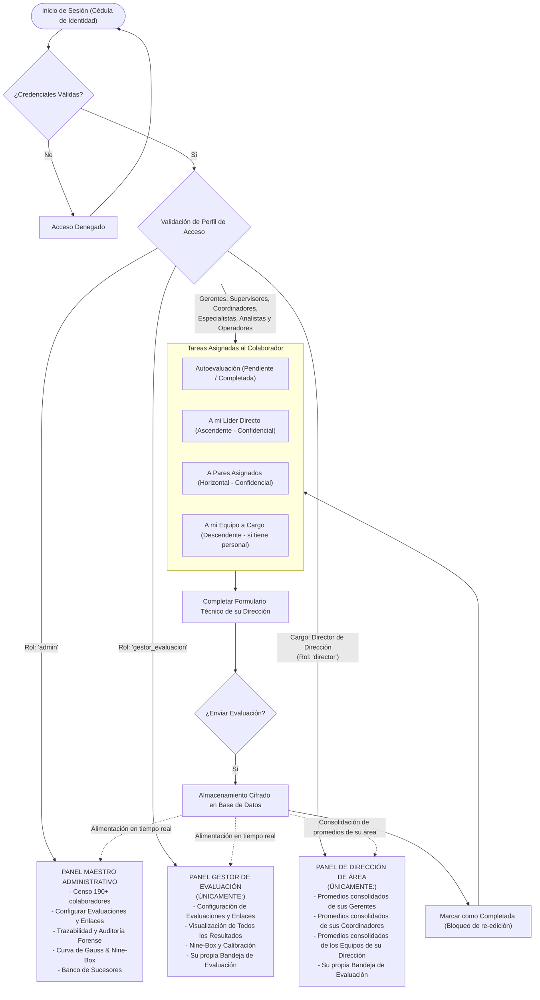

# Sistema de Gestión del Desempeño y Talento 360° / 180°
## DISTRICUEROS EL CANGURO, C.A. — «Universo Canguro»
### Dirección de Talento Humano | Gerencia de Formación y Desarrollo

Plataforma corporativa oficial para la administración del ciclo de **Evaluación del Desempeño por Competencias**, calibración de talento (Curva de Gauss, Nine-Box), Planes de Desarrollo Individual (PDI 70-20-10), Banco de Sucesores y Concursos de Promoción Interna en Venezuela.

---

## 1. Estructura Organizativa y Gobierno Corporativo

La organización opera bajo la siguiente estructura oficial codificada por Talento Humano:

### 1.1 Alta Dirección y Órganos de Gobierno
* **Junta de Accionistas**
* **Presidencia:** *Juan Guillermo Zuluaga*
  * **Consejo Consultivo**
  * **Asesoría Legal Corporativa:** Coordinador Legal $\rightarrow$ Asesor Legal Civil y Mercantil
* **Vicepresidencia:** *Wilson Zuluaga*
  * **Staff Estratégico:** Gerencia Corporativa de Inteligencia de Negocio (BI) (*Gonzalo Vargas*) $\rightarrow$ Coordinador de BI (*Barney Moreno*) $\rightarrow$ Especialistas y Analistas de BI.

### 1.2 Las 8 Direcciones Corporativas (Organigramas Oficiales 2026)

| Código | Dirección Corporativa | Director(a) Titular | Foco de Gestión y Alcance |
| :---: | :--- | :--- | :--- |
| **`DTH-DG-OG-001`** | **Talento Humano** | **Jeanette Arvelo** | Reclutamiento & Selección, Gestión Operativa Zonas 1 y 2, Eventos y Patrocinios, **Formación y Desarrollo**, Nómina y Beneficios. |
| **`DTH-DG-OG-006`** | **Operaciones (Red de Tiendas)** | **Luis González** | 10 Gerentes de Operaciones, 24 Supervisores Regionales (SRT), 180 Coordinadores de Tienda, 206 Responsables, 1.387 Asesores de Tienda y 170 Técnicos Fix. Gestión Operativa e Innovación. |
| **`DTH-DG-OG-010`** | **Transporte y Logística** | **Gabriel Saavedra** | Almacén Central, Logística Inversa (Garantías), Picking, Despacho, Gestión y Traslado, Flota de Transporte (18 Choferes) y Operadores Integrales. |
| **`DTH-DG-OG-009`** | **Tecnología de la Información (TI)** | **Harold Veracierta** | Transformación Digital (PMO), Servicios Tecnológicos (Help Desk), Operaciones Retail, Soluciones Tecnológicas, Desarrollo (Odoo, Integraciones), Infraestructura y Cloud. |
| **`DTH-DG-OG-004`** | **Administración y Finanzas** | **Gustavo Arria** | Planificación Financiera, Administración & CxP, Tesorería & CxC (Liquidación de Fondos), Contabilidad General y Fiscal, Tributos y Gestión Fiscal. |
| **`DTH-DG-OG-005`** | **Comercial** | **Juan Pablo Layrisse** | Desarrollo y Expansión, Portafolio y Precio, Infraestructura & Proyectos, Desarrollo Comercial (B2B/SRC), Alianzas Comerciales, Trade Marketing, Mercadeo, Marketing, E-Commerce. |
| **`DTH-DG-OG-003`** | **Compras** | **Juan Diego Ayala** | Cadena de Suministro, Procesos, Optimización & Control Financiero de Abastecimiento, Gestión de Compras (Compradores y Planificadores de la Demanda). |
| **`DTH-DG-OG-008`** | **Control Interno** | **Jacobo Caicedo** | Auditoría Interna (24 Auditores Regionales), CECOM (Centro de Monitoreo con 9 Operadores), Servicio al Cliente (Atención de Reclamos). |

---

## 2. Escalafón y Nomenclatura de Cargos en Venezuela

El modelo de competencias estandariza las posiciones en 6 niveles de gestión:

```
Nivel 1: Director           (Alta Dirección / Estratégico Alto)
Nivel 2: Gerente            (Nivel Táctico / Estratégico Medio)
Nivel 3: Supervisor         (Nivel Táctico / Supervisorio Regional o de Área)
Nivel 4: Coordinador        (Nivel Técnico-Operativo de Coordinación y Liderazgo de Proyectos)
Nivel 5: Especialista       (Nivel Profesional Senior / Asesor Técnico Especializado)
Nivel 6: Analista / Operador(Nivel Profesional Operativo / Soporte Técnico / Tienda)
```

---

## 3. Arquitectura de Seguridad y Matriz de Roles (RBAC)

Por directriz de seguridad institucional y gobernanza en el ciclo evaluativo, la plataforma cuenta con 4 niveles de acceso claramente diferenciados:

1. **Administrador (`admin`):**
   * Control total e irrestricto: censo, configuración del ciclo, asignación de evaluadores, visualización de todos los resultados, Banco de Sucesores, auditoría forense y gestión de base de datos/credenciales.
2. **Gestor de Evaluación (`gestor_evaluacion`):**
   * **Perfil Operativo Especializado:** Autorizado **únicamente** para:
     * **Configurar las Evaluaciones:** Parámetros del ciclo (180° / 360°), reactivos por competencias y matriz de asignación interna.
     * **Visualizar Todos los Resultados:** Acceso a todos los expedientes de colaboradores, radares de brechas, promedios por dirección y matrices de desempeño (Nine-Box / Gauss).
     * **Bandeja Personal:** Llenar sus propias evaluaciones asignadas.
     * **Restricciones estrictas:** Sin acceso a Banco de Sucesores (cargos directivos críticos), auditoría forense técnica ni gestión de credenciales.
3. **Director de Dirección (`director`):**
   * **Visualización Exclusiva de Promedios:** En la línea de negocio, **únicamente el Director de la Dirección puede visualizar los promedios consolidados del equipo y de los líderes (Gerentes y Coordinadores)** dentro de su Dirección. No ve respuestas nominales individuales para preservar el anonimato.
   * **Bandeja Personal:** Responder su propia autoevaluación y las evaluaciones asignadas a su cargo.
4. **Mandos Medios y Colaboradores (`colaborador`):**
   * **Aplica a:** Gerentes, Supervisores, Coordinadores, Especialistas, Analistas y Operadores.
   * **Bloqueo Total de Resultados:** El líder evaluado (Gerente, Supervisor, Coordinador) **NO visualiza ningún resultado ni promedio** de su evaluación en la plataforma.
   * **Bandeja Única de Evaluación:** Al iniciar sesión con su cédula, **únicamente accede a su Bandeja Personal de Evaluaciones Asignadas** (*Mis Evaluaciones por Realizar*).

### Resumen de Permisos por Rol

| Módulo / Capacidad | Administrador (`admin`) | Gestor de Evaluación (`gestor_evaluacion`) | Director de Área (`director`) | Líderes y Colaboradores (`colaborador`) |
| :--- | :---: | :---: | :---: | :---: |
| **Configurar Evaluaciones & Asignación** |  **Permitido** |  **Permitido** |  Bloqueado |  Bloqueado |
| **Visualizar Resultados Globales** |  **Permitido** |  **Permitido** |  Bloqueado |  Bloqueado |
| **Visualizar Promedios de su Dirección** |  **Permitido** |  **Permitido** |  **Permitido (Solo Promedios)** |  Bloqueado (Cero Resultados) |
| **Bandeja Personal de Evaluaciones** |  **Permitido** |  **Permitido** |  **Permitido** |  **Permitido (Único acceso)** |
| **Banco de Sucesores Directivo** |  **Permitido** |  **Bloqueado** |  Bloqueado |  Bloqueado |
| **Auditoría Forense y Logs Técnicos** |  **Permitido** |  **Bloqueado** |  Bloqueado |  Bloqueado |
| **Gestión de Censo y Base de Datos** |  **Permitido** |  **Bloqueado** |  Bloqueado |  Bloqueado |

---

## 4. Tipificación de Evaluaciones y Reglas de Negocio

### 4.1 Subordinación Formal (Evaluación Ascendente)
* **Regla:** Cuando un colaborador evalúa a su líder directo según organigrama (por ejemplo, *Freddy Molina - Analista de Procesos* evaluando a *Natalia Rodríguez - Coordinadora de Desarrollo y Desempeño*, o *Ahira Pérez - Especialista de Formación* evaluando a *Bárbara Vásquez - Coordinadora de Formación*), la evaluación se registra con tipo **`subordinate`**.
* **Confidencialidad y Seguridad Psicológica:** El evaluado **únicamente observa el promedio general consolidado de su equipo**. No se muestra la identidad individual, cédula ni respuesta discriminada por persona, garantizando la honestidad, seguridad psicológica y objetividad del proceso.

### 4.2 Segmentación Estricta por Dirección y Departamento
* **Pertinencia Funcional:** Los colaboradores y evaluadores **únicamente tienen acceso al módulo e instrumento de evaluación técnica que corresponde a su respectiva Dirección y Departamento**.
* Está estrictamente restringido y bloqueado en el sistema el acceso a instrumentos o preguntas técnicas de áreas ajenas (e.g. un colaborador de Operaciones no puede visualizar ni diligenciar el módulo técnico de Tecnología o Administración y Finanzas).

### 4.3 Evaluación entre Pares (`peer`)
* Colegas de la misma banda jerárquica asignados por Talento Humano dentro de la misma área funcional o procesos transversales. Sus respuestas son anónimas y se consolidan en el bloque de pares.

### 4.4 Evaluación Descendente (`supervisor`)
* El líder directo evalúa a sus subordinados asignados según el perfil y nivel del cargo. Esta evaluación es nominal y sustenta la sesión de retroalimentación y el PDI.

### 4.5 Autoevaluación (`self`)
* Aplica al 100% de la población evaluada contra las conductas esperadas de su propio puesto de trabajo dentro de su Dirección.

### 4.6 Cronómetro en Vivo y Auto-guardado Offline (LocalStorage)
* **Tiempo de Diligenciamiento:** El instrumento incorpora un contador de tiempo activo (`Timer`) que cronometra los minutos y segundos que el evaluador dedica en el navegador para completar el instrumento.
* **Auto-guardado Offline:** Cada selección o comentario se respalda automáticamente de forma local e instantánea en el navegador (`localStorage`). Si se interrumpe la conexión o se cierra la pestaña, el usuario puede retomar su evaluación exactamente donde la dejó sin perder datos.

### 4.7 Modalidades de Habilitación: Masiva vs. Presencial Individual
* **Evaluación del Desempeño por Competencias (Habilitación Masiva):** Puede activarse en masa para todo el censo o por Direcciones/Departamentos completos. Los colaboradores ingresan de forma remota y autónoma con su número de cédula.
* **Concurso de Promoción y Ascenso (Estrictamente Individual y Presencial):** Requiere que el colaborador postulado presente la prueba situacional y psicométrica **presencialmente en sitio junto con la encargada de Talento Humano**. No se permite su realización a distancia ni su activación masiva.

---

## 5. Diagrama de Flujo del Proceso Evaluativo



---

## 6. Esquema de Base de Datos para Líneas de Reporte

Para materializar las relaciones jerárquicas exactas de los organigramas corporativos:

```sql
-- Tabla de Líneas de Reporte Organizacional (Jerarquía)
CREATE TABLE IF NOT EXISTS reporting_lines (
    id VARCHAR(64) PRIMARY KEY,
    subordinate_id VARCHAR(64) NOT NULL REFERENCES collaborators(id) ON DELETE CASCADE,
    supervisor_id VARCHAR(64) NOT NULL REFERENCES collaborators(id) ON DELETE CASCADE,
    relationship_type VARCHAR(32) DEFAULT 'direct_report', -- 'direct_report', 'matrix_report'
    created_at TIMESTAMPTZ DEFAULT NOW(),
    UNIQUE(subordinate_id, supervisor_id)
);

CREATE INDEX IF NOT EXISTS idx_rep_sub ON reporting_lines(subordinate_id);
CREATE INDEX IF NOT EXISTS idx_rep_sup ON reporting_lines(supervisor_id);
```

---

## 7. Comandos de Ejecución

```bash
# Instalar dependencias
npm install

# Iniciar servidor de desarrollo en http://localhost:3000
npm run dev

# Compilar para producción
npm run build
npm start
```
